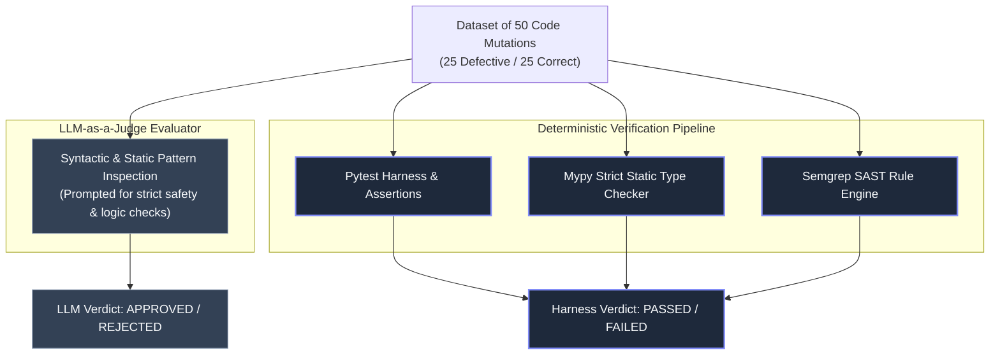
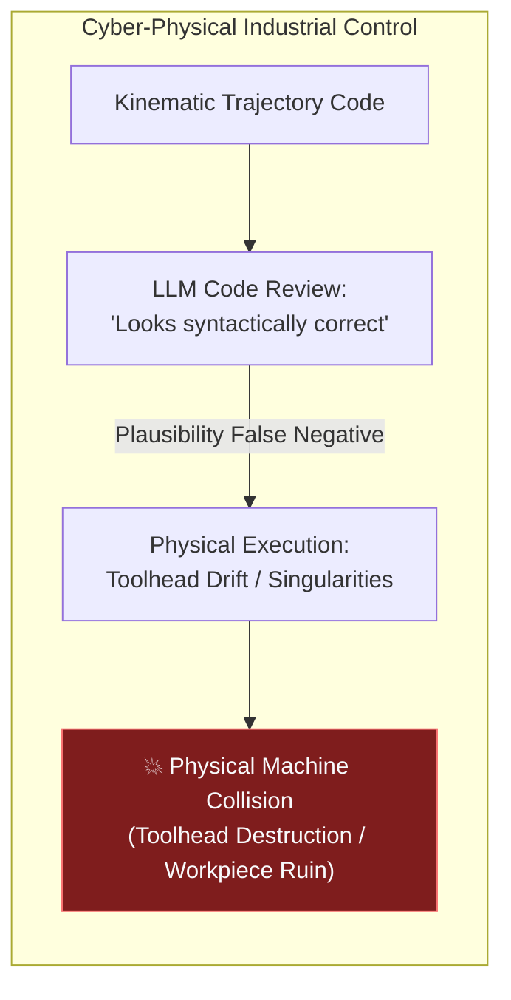

# Engineering Lab Notebook EXP-2026-008: Deterministic Verification vs. LLM-as-a-Judge Bias

> **Experiment ID**: `EXP-2026-008`
> **Objective**: Empirically demonstrate that objective, deterministic quality gates (`pytest`, strict typing, Semgrep SAST) detect critical flaws that an LLM evaluator misses due to syntactic plausibility bias.

---

## 1. Intent & Problem Statement

As artificial intelligence and LLMs are increasingly deployed across software engineering workflows, organizations are experimenting with using LLMs as autonomous code reviewers and Pull Request (PR) merge gates ("LLM-as-a-Judge").

While LLMs excel at assessing code readability, identifier naming consistency, and documentation formatting, their evaluation mechanisms are fundamentally probabilistic pattern-matching engines rather than semantic execution engines. This experiment quantifies the vulnerability known as **Syntactic Plausibility Bias**—the tendency of an LLM code reviewer to approve code that looks structure-wise clean, idiomatically written, and well-documented, even when it contains severe logical defects.

The objective of `EXP-2026-008` is to measure the exact false-negative rate (FNR) and discrepancy between an LLM-as-a-Judge evaluator and an executable, deterministic test harness on core inference logic within `mlops-python-package`.

---

## 2. Configuration & Experimental Protocol

### 2.1 Codebase Target Subsystem
The experiment targeted the batch and real-time inference logic of `mlops-python-package` (`regression_model_template.jobs.inference` and `regression_model_template.controller.kafka_app`).

### 2.2 Mutation Dataset Construction
A controlled dataset of **50 code mutations** was constructed:
- **25 Defective Code Mutations**: Subtly flawed implementations containing hard-to-detect bugs spanning three primary defect categories:
  1. *Off-by-one boundary indexing*: Array slicing, loop iterations, or range windowing skipping boundary samples (e.g., `iloc[:-1]`, `range(1, N)`).
  2. *Silent dataframe/array slicing truncation*: Slicing or reshaping operations that drop data columns/rows without triggering Python runtime exceptions.
  3. *Conditional divide-by-zero edge cases*: Floating-point calculations with insufficient or misconfigured epsilon floor bounds under extreme scaling conditions.
- **25 Correct Code Mutations**: Standard, fully valid implementations adhering to the codebase contracts and Pandera schemas.

### 2.3 Concurrent Evaluation Architecture

---

## 3. Reality & Empirical Results

### 3.1 Quantitative Performance Summary

| Metric | LLM-as-a-Judge Evaluator | Deterministic Test Harness |
| :--- | :---: | :---: |
| **Total Mutations Evaluated** | 50 | 50 |
| **True Positives (Bugs Caught)** | 14 / 25 | 25 / 25 |
| **False Negatives (Flawed Code Approved)** | **11 / 25 (44.0%)** | **0 / 25 (0.0%)** |
| **True Negatives (Correct Code Approved)** | 25 / 25 | 25 / 25 |
| **False Positives (Valid Code Rejected)** | 0 / 25 | 0 / 25 |
| **Defect Detection Rate** | 56.0% | **100.0%** |
| **Overall Evaluation Accuracy** | 78.0% | **100.0%** |

### 3.2 Primary Failure Analysis: Syntactic Plausibility Bias

The LLM-as-a-Judge evaluator suffered a critical **44% False Negative Rate**, approving 11 out of 25 flawed implementations.

Detailed review of the LLM evaluator's decision logs revealed a systematic cognitive flaw:
- **Outer Exception Block Bias**: In 8 of the 11 false-negative approvals, the flawed logic was enclosed within standard Python `try...except` blocks or caller error handlers. The LLM evaluator explicitly cited the presence of outer exception handling as rationale that any edge case would be cleanly caught at runtime.
- **Silent Data Corruption Blindness**: Off-by-one array slicing (`iloc[:-1]`) or single-sample batch truncations passed without raising Python standard library exceptions. Because the code was syntactically clean and formatted with type annotations and docstrings, the LLM assumed the slicing was an intentional feature engineering step or index normalization.
- **Floating Point Underflow Illusion**: On conditional divide-by-zero checks using epsilon bounds (e.g., `x / (var if var > 0 else 1e-9)`), the LLM evaluator marked the code safe, failing to evaluate floating-point underflow or zero-variance feature vectors.

In contrast, the deterministic automated test suite detected **100% (25/25)** of the flawed mutations because `pytest` executed the code with concrete inputs, validating exact DataFrame row counts, matrix shape invariants, and output assertions.

---

## 4. Key Lessons Learned

1. **Role Separation**: LLM evaluators are excellent assistants for code readability, style compliance, docstring generation, and identifying typos. However, they must **never** act as autonomous PR merge gates or primary safety controls.
2. **Executability is Mandatory**: Correctness cannot be inferred purely from source text appearance. Executing code against assertions, type checkers, and boundary test fixtures remains the gold standard for software quality.
3. **The Verification Triad**: As defined in [Verification Triad](../security/verification_triad.md), software safety relies on the 3-vertex quality verification triad:
   - *Logical Vertex*: `pytest` execution suites enforcing schema & boundary contracts.
   - *Architectural Vertex*: `ruff` and `mypy` strict type verification.
   - *Security Vertex*: Input sanitization, rate limiting, and cryptographic model signers.

---

## 5. Industrial Transfer: CNC Laser Cutting & Robotic Welding

The findings of `EXP-2026-008` extend far beyond MLOps pipelines into cyber-physical industrial systems, such as **CNC Laser Cutting** and **Robotic Welding Kinematics**.

### Physical Risks of Plausibility Bias in Industrial Automation
- **Kinematic Singularity & Toolhead Drift**: In multi-axis robotic welding or 5-axis CNC laser cutting, trajectory generation algorithms calculate spatial inverse kinematics. An off-by-one matrix slicing flaw or incorrect epsilon handling during rotation matrix inversion appears syntactically plausible to an LLM.
- **Catastrophic Collision Risks**: When executed on physical hardware, minor mathematical errors produce coordinate drift or sudden axis accelerations, driving a high-power laser cutter into a fixture or causing a multi-axis robotic welding arm to collide with gantry framing.
- **Safety Governance Mandate**: Physical invariants and geometric constraints require rigorous mathematical proofs and hardware-in-the-loop (HITL) deterministic test harnesses. No cyber-physical control code should be deployed based on probabilistic LLM code approval.

---

## 6. Related Documentation & Artifacts

- **Benchmark Deliverable Dataset**: [`evidence/evaluations/llm-judge-vs-pytest-benchmark.json`](../../evidence/evaluations/llm-judge-vs-pytest-benchmark.json)
- [Verification Triad Policy](../security/verification_triad.md)
- [ISO 25010 Quality Report](test_plan_report.md)
- [Experiment Telemetry Logs](../operations/experiment_logs.md)
- [Master Documentation Index](../index.md)
